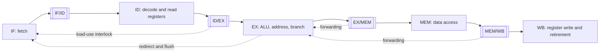

# Pipeline Architecture Proposal

This note turns the Phase 2 guide into an implementation plan for this
repository. It describes interfaces and invariants; it does not make the
student's open architectural choices or replace the Phase 1 core.

## Starting point

The existing `rv32i_core` is a single-cycle reference. It has separate
instruction and data ports, combinational reads, synchronous writes, and a
precise halt-on-trap contract. The Phase 1 tests compare every retired
instruction and final state against a Python reference model. Keep these
sources and B001 reports intact while the pipeline is developed alongside it.

The proposed pipeline handles one instruction per stage per cycle when there
are no stalls. Its architectural retirement stream must match the single-cycle
core, even though its cycle count and internal timing differ.

## Stage responsibilities

| Stage | Work | State that must remain associated with the instruction |
|-------|------|---------------------------------------------------------|
| IF | Select PC and request instruction | PC and fetch validity/fault |
| ID | Decode, read registers, form immediate | Raw instruction, source/destination indices, operands, immediate, controls, illegal-instruction status |
| EX | Forward operands, execute ALU, compare branch, calculate address/target | ALU result, branch/redirect result, store operand, exception status |
| MEM | Access data memory and produce load value | Load result or store effect, memory fault/alignment status |
| WB | Select architectural result, write `rd`, report retirement | PC, instruction, destination/value, committed store fields, trap metadata |

Every pipeline boundary needs a `valid` bit. Reset, bubbles, and flushed
instructions clear validity; they must not be represented by a plausible NOP
alone because a NOP is still a valid instruction that retires.

## Pipeline register payloads

These are the minimum logical fields. The student can choose packed structs or
explicit signals after deciding the memory and branch timing.

| Boundary | Suggested payload |
|----------|-------------------|
| IF/ID | `valid`, `pc`, `instruction`, fetch-fault indication |
| ID/EX | `valid`, `pc`, `instruction`, `rs1/rs2/rd`, `rs1/rs2` values, immediate, `funct3`, ALU operation, operand selects, branch/jump controls, memory controls, writeback select, register-write enable, decode exception |
| EX/MEM | `valid`, `pc`, `instruction`, `rd`, ALU result/address, store value, store size/strobes/data, load/store enables, writeback select, register-write enable, branch result, exception/cause/value |
| MEM/WB | `valid`, `pc`, `instruction`, `rd`, final writeback value, register-write enable, committed memory-effect fields, exception/cause/value |

Avoid carrying controls that are no longer needed past a boundary. For
example, `mem_write` is needed through MEM, while the selected register value
is needed through WB.

## Data hazards

### Forwarding

For each EX source, prefer the newest older in-flight producer:

1. EX/MEM when it is valid, writes a nonzero destination matching the source,
   and its result is available for forwarding.
2. Otherwise MEM/WB when it is valid, writes a nonzero matching destination.
3. Otherwise use the value captured from the register file.

The newest match wins when multiple older instructions write the same
register. Register `x0` never creates a dependency. Source-use detection must
come from the decoded instruction class; immediate bits that happen to occupy
the `rs2` field must not cause a false stall.

### Load-use interlock

The guide's starting behavior is a one-cycle load-use bubble. When the
instruction in ID needs a destination being loaded by the instruction in EX,
hold the PC and IF/ID entry for one cycle, let the load advance, and insert an
invalid entry into ID/EX. Do not hold the load in EX or discard the dependent
instruction.

The exact condition depends on the chosen memory contract. The current Phase 1
data port is combinational-read; a registered-read or variable-latency port
changes when load data becomes forwardable. Resolve this together with the
memory-interface decision before coding the hazard unit.

## Control hazards and flushes

EX resolution is the simplest starting point and matches the current separate
`branch_unit` and `next_pc_logic` structure. It is a recommendation, not a
selected decision. With EX resolution, a taken branch or jump redirects the
fetch PC and invalidates all younger instructions in IF and ID. A not-taken
branch does not flush. JAL and JALR still write `PC + 4`; JALR clears target
bit 0 before alignment checking, as the existing Phase 1 logic does.

All side-effect enables travel with `valid`. A flushed or invalid instruction
must never write a register, write data memory, or appear in the retirement
trace. Add tests for a wrong-path store and wrong-path register write before
claiming flush correctness.

## Precise traps and retirement

The single-cycle core halts on the first exception without committing that
instruction. In a pipeline, do not halt immediately when an exception is first
detected if older instructions are still in flight. Carry trap cause, PC, and
value with the faulting entry; stop fetching and squash younger entries; allow
older entries to complete; then report the trap when it reaches the in-order
commit point. The faulting entry itself must not write a register or memory.

The comparison record should include, at minimum:

- retiring PC and instruction word;
- register destination and value when a register write commits;
- store byte address, data, and byte enables when a store commits;
- trap PC, cause, and trap value for a terminating exception.

Ignore cycle numbers when comparing with the Phase 1 reference. Stop and show
the first mismatching record with nearby context.

## Memory timing choices

The current Phase 1 memories use asynchronous reads because one instruction
must complete in one cycle. A pipeline can preserve that interface initially,
or introduce registered reads to use FPGA block RAM. The choice changes the
stage timing, load-use condition, and potentially fetch stalls. Keep AXI and
caches out of this milestone, as the project guide recommends.

| Choice | Benefit | Cost |
|--------|---------|------|
| Preserve combinational ports | Smaller first change; isolates pipeline control and hazards | Memories remain on LUT/distributed-RAM paths and may limit Fmax |
| Use registered-read memories | Natural fit for block RAM and larger memories | Requires explicit request/response timing and changes the interlock/flush design |

No choice is recorded yet. The Phase 1 core must remain runnable whichever
option is selected.

## Build sequence

1. Agree on branch-resolution and memory timing, and record them in
   [`../phase_2/decisions.md`](../phase_2/decisions.md).
2. Agree on the retirement record and add pipeline stage-valid visibility.
3. Implement straight-line ALU instructions and compare retirement against the
   reference core.
4. Add forwarding; cover EX/MEM, MEM/WB, and repeated-destination priority.
5. Add loads/stores and the selected load-use policy.
6. Add branches and jumps, redirects, and wrong-path suppression.
7. Preserve the passing results and measure the initial pipeline against B001.

The corresponding exit criteria are tracked in
[`../phase_2/checklist.md`](../phase_2/checklist.md).
